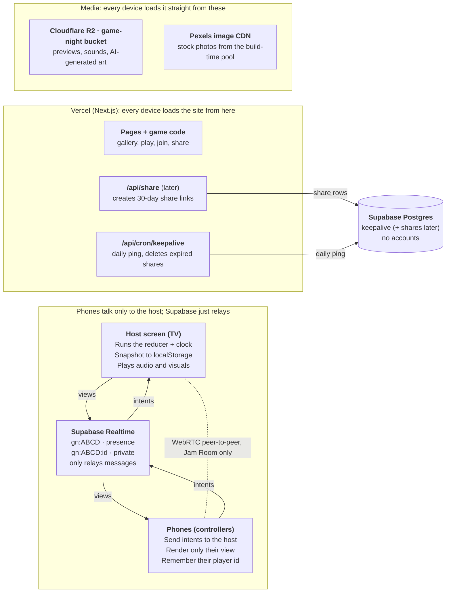
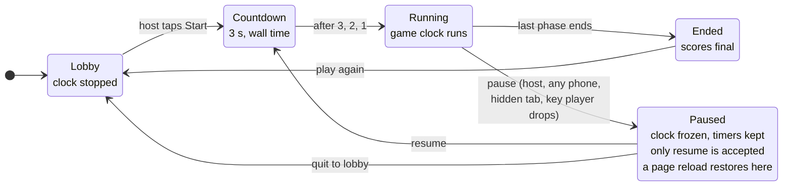

# Game Night — Architecture

The technical design. Locked: changes go through [DECISIONS.md](DECISIONS.md). The wire protocol is in [PROTOCOL.md](PROTOCOL.md); the site and UI kit are in [SITE_AND_UI.md](SITE_AND_UI.md).

## System at a glance

Next.js on Vercel for the site, **Supabase Realtime** (Broadcast + Presence) as the pipe between the host screen and phones, the **host browser as the single source of game truth**, and a **Cloudflare R2** bucket for media. The database holds only a keep-alive row (and, later, short-lived share links). There are no accounts.



The host is the only device holding game state. Supabase relays messages, Vercel serves pages plus small API routes, and media loads straight from R2 and Pexels.

## Stack

| Decision             | Choice                                                           | Why                                                                                          |
| -------------------- | ---------------------------------------------------------------- | -------------------------------------------------------------------------------------------- |
| Framework            | Next.js (App Router) + TypeScript                                | Zero-config on Vercel; games are client components                                           |
| Monorepo             | pnpm workspaces + Turborepo                                      | Shared packages, one package per game, cached builds                                         |
| Hosting              | Vercel Hobby                                                     | Static gallery + a few API routes                                                            |
| Realtime transport   | Supabase Realtime Broadcast + Presence                           | Hosted WebSockets with fan-out and presence built in                                         |
| Game state authority | Host browser (pure reducer)                                      | No server game loop; Screen games work offline                                               |
| Database             | Supabase Postgres: `keepalive` now, `shares` later               | No accounts or history; room existence comes from presence, crash recovery from localStorage |
| Media                | Cloudflare R2: `game-night` bucket on `game-night.kylehagerman.dev` | No egress fees; gallery previews, sounds, generated art                                   |
| Redis                | Not used                                                         | Everything lives in Supabase and R2                                                          |
| Styling              | Tailwind CSS v4 + per-game CSS variables                         | Shared tokens, unique skins                                                                  |
| Audio                | Tone.js over Web Audio                                           | Instruments, scheduling, a transport that pauses                                             |
| Validation           | Zod                                                              | Configs, content packs and network messages share schemas                                    |
| Client state         | Zustand store fed by the engine                                  | Simple subscriptions per screen                                                              |
| Unit tests           | Vitest + fast-check                                              | Fast reducer tests; property test for pause                                                  |
| E2E tests            | Playwright                                                       | One browser context per device                                                               |

Exact versions are pinned in [DECISIONS.md](DECISIONS.md) (D-020).

### Why Supabase over Redis or Vercel's own WebSockets

- **Redis alone can't push.** Upstash's free tier is 500K commands a month ([Upstash pricing](https://upstash.com/docs/redis/overall/billing)). Phones would have to poll: 8 phones polling twice a second for a 2-hour night is about 115K commands, so roughly four game nights a month.
- **Vercel WebSockets are new and constrained.** They entered public beta on June 22, 2026. On Hobby a connection closes at 300 s, connections pin to one instance, and fanning a room out across instances needs Redis pub/sub ([Vercel KB](https://vercel.com/kb/guide/do-vercel-serverless-functions-support-websocket-connections)). Worth revisiting once it's GA.
- **Supabase Realtime gives rooms for free:** a channel per room, Broadcast for messages, Presence for who's connected.

### Supabase free-tier limits that shape the design

| Limit (Free plan)                      | Value                                                                  | Design response                                                                                             |
| -------------------------------------- | ---------------------------------------------------------------------- | ----------------------------------------------------------------------------------------------------------- |
| Concurrent connections                 | 200                                                                    | About 20 full rooms at once; plenty                                                                         |
| Messages per second, whole project     | 100                                                                    | Counts each message sent _and_ each delivery. Send state on change, never on a tick; split up/down channels |
| Presence calls per client              | 5 per 30 s                                                             | Presence only for join/leave, never game data                                                               |
| Broadcast payload                      | 256 KB                                                                 | Keep snapshots under 16 KB                                                                                  |
| Client send rate (supabase-js default) | 10 events/s, configurable                                              | Batch high-rate input such as jam notes                                                                     |
| Inactivity pause                       | Free projects with too little database activity over 7 days are paused | A daily Vercel Cron job touches the database; essential, since nothing else does                            |

Sources: [Supabase Realtime limits](https://supabase.com/docs/guides/realtime/limits), [Supabase project pausing](https://supabase.com/docs/guides/platform/free-project-pausing), [Supabase Broadcast](https://supabase.com/docs/guides/realtime/broadcast).

The worked message budget is in [PROTOCOL.md](PROTOCOL.md#message-budget).

### Transport adapter

`packages/realtime` hides the provider behind one interface so a game never imports Supabase directly:

| Adapter             | Use                                                                                                                     |
| ------------------- | ----------------------------------------------------------------------------------------------------------------------- |
| `SupabaseTransport` | Default for Party games                                                                                                 |
| `LoopbackTransport` | Dev and tests: host and players in separate tabs on one machine via the browser's BroadcastChannel; no network, no keys |
| `WebRTCTransport`   | Jam Room: low-latency peer-to-peer, signaled over Supabase                                                              |
| `VercelWsTransport` | Optional later, once Vercel WebSockets are GA                                                                           |

## Media on Cloudflare R2

A dedicated bucket, `game-night`, separate from any other site's bucket so they never share keys, CORS rules or cleanup.

| Item              | Setup                                                                                                                                                                                       |
| ----------------- | ------------------------------------------------------------------------------------------------------------------------------------------------------------------------------------------- |
| Public URL        | `https://game-night.kylehagerman.dev`, a custom domain on the bucket. The `r2.dev` URL is rate-limited and meant for development only ([R2 public buckets](https://developers.cloudflare.com/r2/buckets/public-buckets/)) |
| Key layout        | `games/<slug>/cover.webp`, `games/<slug>/shots/*.webp`, `games/<slug>/preview.webm`, `sounds/<pack>/*`, `art/ai/<pool>/*.webp`                                                              |
| Uploads           | `pnpm upload-media` uses R2's S3-compatible API with an access key that lives only on the developer's machine, never on Vercel                                                              |
| Caching           | File names carry a content hash; uploads set `Cache-Control: public, max-age=31536000, immutable`                                                                                           |
| CORS              | Allow GET from the site's origins (production, Vercel previews, localhost); Web Audio and canvas can't use cross-origin files without it                                                    |
| Images in Next.js | Upload pre-sized WebP and serve it directly, skipping Vercel's image optimizer                                                                                                              |

R2's free tier covers 10 GB-month of storage, 1 million Class A (write) and 10 million Class B (read) operations a month, with no egress fees ([R2 pricing](https://developers.cloudflare.com/r2/pricing/)). Pexels photos are not copied to R2; they load straight from Pexels, which keeps attribution simple.

### Environment variables

| Variable | Where | Notes |
| -------- | ----- | ----- |
| `NEXT_PUBLIC_SUPABASE_URL` | Vercel | Public by design |
| `NEXT_PUBLIC_SUPABASE_ANON_KEY` | Vercel | Public by design |
| `SUPABASE_SECRET_KEY` | Vercel, server only | Keep-alive job (and share links, later) |
| `NEXT_PUBLIC_MEDIA_URL` | Vercel | `https://game-night.kylehagerman.dev` |
| `PEXELS_API_KEY` | Vercel server only (for `/api/images`, later); local for `pnpm build:images` | |
| `CRON_SECRET` | Vercel | Authenticates the cron route |
| `R2_ACCOUNT_ID`, `R2_ACCESS_KEY_ID`, `R2_SECRET_ACCESS_KEY`, `R2_BUCKET=game-night` | Local machine only | Used by `pnpm upload-media` |

Local values live in a git-ignored `.env.local`; `.env.example` lists every key with no values.

## Monorepo structure

One app, a handful of shared packages, and one self-contained package per game. A game depends only on shared packages, never on another game or on the app.

```text
game-night/
├─ apps/
│  └─ web/                             Next.js site
│     ├─ app/
│     │  ├─ page.tsx                    gallery
│     │  ├─ games/[slug]/page.tsx       game page: preview, how to play, start
│     │  ├─ games/[slug]/play/page.tsx  host screen or single-screen play
│     │  ├─ games/[slug]/showcase/page.tsx  renders a frozen showcase state for screenshots
│     │  ├─ join/page.tsx               type a room code
│     │  ├─ j/[code]/page.tsx           phone controller (QR target)
│     │  ├─ s/[id]/page.tsx             shared results, read-only (later)
│     │  └─ api/
│     │     ├─ share/route.ts           creates a share link (later)
│     │     ├─ images/route.ts          Pexels proxy + cache (later)
│     │     └─ cron/keepalive/route.ts  keeps Supabase awake (and deletes expired shares, later)
│     └─ registry.ts                    installed games, lazy-loaded
├─ packages/
│  ├─ engine/     GameDefinition types, runner, game clock, pause, seeded RNG, scoring helpers
│  ├─ realtime/   Transport interface; Supabase, Loopback, WebRTC adapters; room codes; protocol schemas
│  ├─ ui/         Lobby, RoomCode + QR, PlayerList, Countdown, PauseOverlay, Timer, Scoreboard, InfoSheet
│  ├─ audio/      audio unlock, SFX, Tone.js setup, speech-to-text and text-to-speech helpers
│  ├─ content/    content schemas with ratings, content-mode filtering, shared word lists, validator
│  ├─ media/      URL helper for files on the R2 media domain
│  ├─ devtools/   debug overlay, fake-player bots
│  └─ config/     shared tsconfig, ESLint flat config, Tailwind theme (CSS)
├─ games/
│  └─ <slug>/
│     ├─ SPEC.md               source of truth
│     ├─ game.json             gallery metadata (see SITE_AND_UI.md)
│     ├─ src/
│     │  ├─ index.ts           exports the GameDefinition
│     │  ├─ logic.ts           pure reducer + phases, no React, no browser APIs
│     │  ├─ views.ts           what each device may see
│     │  ├─ screens/           Host.tsx, Controller.tsx, Screen.tsx, Share.tsx
│     │  ├─ theme.css
│     │  └─ content/*.json
│     ├─ media/                covers, screenshots, sounds; published to R2 by pnpm upload-media
│     └─ test/logic.test.ts
├─ supabase/migrations/        keepalive table (shares later)
├─ docs/                       design docs (this folder)
├─ scripts/                    new-game.ts, screenshots.ts, upload-media.ts, build-images.ts, validate-content.ts
├─ CLAUDE.md                   instructions for AI coding agents
└─ turbo.json, pnpm-workspace.yaml
```

Script commands: `pnpm new-game`, `pnpm screenshots`, `pnpm upload-media`, `pnpm build:images`, `pnpm validate-content`.

### How a game plugs in

1. `pnpm new-game <slug>` copies the template folder, creates `SPEC.md` from [GAME_SPEC_TEMPLATE.md](GAME_SPEC_TEMPLATE.md), and adds an entry to `registry.ts`.
2. Each game is a workspace package named `@games/<slug>`, listed in `transpilePackages` in `next.config`.
3. `registry.ts` maps slug → `{ meta, load: () => import('@games/<slug>') }`. The gallery reads only `meta`; a game's code, audio and content load when someone opens it.
4. `logic.ts` stays free of React and browser APIs so it runs in unit tests and could move to a server later without changes.
5. Shared UI is opt-in. A game can use the stock Lobby and Scoreboard, or render its own and still call the same engine hooks.

## Shared game engine

Every game is a pure reducer that the host runs. The engine wraps it with a pausable game clock, timers stored as data, a seeded random generator, and a per-device view function. Because time only moves when the engine says so, pausing can never corrupt a timed game.

### The game definition

```ts
export interface GameDefinition<Config, State, Intent, HostView, PlayerView> {
  meta: GameMeta; // from game.json
  modes: Array<"screen" | "party" | "hybrid">;
  players: { min: number; max: number };
  lateJoin: "allow" | "spectate" | "deny";
  config: { schema: ZodType<Config>; defaults: Config }; // lobby settings form is generated from this
  intentSchema: ZodType<Intent>; // validates everything a phone sends

  setup(ctx: SetupCtx<Config>): State; // players, config, content mode, seeded rng
  reduce(state: State, action: Action<Intent>, ctx: Ctx): State;
  phase(state: State): { id: string; label: string };
  views: {
    host(state: State): HostView;
    player(state: State, playerId: PlayerId): PlayerView; // private info lives here
  };
  screens: {
    Host?: ComponentType<HostProps<HostView, Intent>>;
    Controller?: ComponentType<ControllerProps<PlayerView, Intent>>;
    Screen?: ComponentType<ScreenProps<State, Intent>>; // single-device mode
  };
  showcase?: Record<string, ShowcaseState<State>>; // seeded frozen moments for gallery shots
  share?: { schema: ZodType; build(state: State): unknown; View: ComponentType }; // later
  onPause?(): void; // e.g. Tone.Transport.pause()
  onResume?(): void;
}

type Action<I> =
  | { type: "intent"; from: PlayerId; intent: I }
  | { type: "timer"; id: string } // a timer reached its end in game time
  | { type: "player"; event: "joined" | "left" | "renamed"; playerId: PlayerId }
  | { type: "host"; command: "next" | "skip" | "restart-round" | "end" }
  | { type: "system"; event: string; data?: unknown }; // async results, e.g. images loaded

interface Ctx {
  now: number; // game time in ms, frozen while paused
  rng: () => number; // seeded; same seed, same game
  startTimer(id: string, ms: number): void; // stored in state.timers as an end time
  clearTimer(id: string): void;
}
```

Rules every game follows:

- `reduce` is pure: no `Date.now()`, no `Math.random()`, no fetches. Time comes from `ctx.now`, randomness from `ctx.rng`.
- Side effects (sounds, speech, image fetches, animations) live in screens and react to phase changes through `usePhaseEffect(phaseId, fn)`. Async results come back as `system` actions.
- Intents are validated twice: against `intentSchema`, then by the reducer for game rules (wrong phase, wrong player, already answered). Rejections return a reason the phone can show.

### Game clock and timers

```ts
gameNow =
  accumulatedMs + (status === "running" ? performance.now() - runningSince : 0);
```

- Timers are stored in state as `{ id, endsAt }` in game time. The runner fires a `timer` action when `gameNow` passes the nearest `endsAt`.
- Pausing adds the elapsed slice to `accumulatedMs` and stops the clock, so every timer freezes with no extra code.
- The clock's time source is injected, so tests drive it by hand.
- Phones never compare clocks. The host sends `remainingMs` with each update and the phone counts down locally from when it received it. A skew of 100–200 ms is invisible at party-game scale.

### Pause and resume

Game status lives on the host; phones mirror it. Every resume goes through the 3-2-1 countdown.



Five states, seven transitions. The game clock only moves in Running, so any path through Paused leaves every timer exactly where it was.

- **Who can pause:** the host screen (button, Space or P), any phone when the `anyoneCanPause` setting is on (default on), automatically when the host tab is hidden, and automatically when a player holding a key role disconnects.
- **While paused:** the engine passes nothing to the reducer, and accepts only `resume`. Phones show the pause overlay; audio, video, speech recognition and CSS animations stop. A `data-paused` attribute on the root sets `animation-play-state: paused` everywhere.
- **Pause menu:** Resume, How to play, Settings (only those that don't change the current round), Restart round, Quit to lobby.
- **Resume:** 3 seconds of wall time showing 3, 2, 1 on every device, then the clock restarts. Music games play the count-in as clicks on the beat.

### Crash recovery

After each state change the host saves `{ state, accumulatedMs, seed }` to localStorage under `gn:room:<code>` (debounced to about once per second). On reload it offers "Resume game ABCD?" and always restores into the Paused state, so recovery goes through the countdown. Phones store their player id per room and rejoin silently.

### Hooks screens use

| Hook                     | Returns                                                    |
| ------------------------ | ---------------------------------------------------------- |
| `useGame()`              | current view, `send(intent)`, clock status, last rejection |
| `useTimer(id)`           | remaining ms, updated per animation frame, pause-aware     |
| `usePhaseEffect(id, fn)` | runs `fn` on entering a phase, cleans up on leaving        |
| `usePlayers()`           | roster with connection status and avatars                  |
| `useAudioUnlock()`       | whether audio may play yet, plus a tap-to-enable prompt    |

## What lives where

Game state never touches the database.

| Data                                       | Lives in                                                | Lifetime                                        |
| ------------------------------------------ | ------------------------------------------------------- | ----------------------------------------------- |
| Canonical game state                       | Host memory                                             | The session                                     |
| Recovery snapshot                          | Host localStorage                                       | Until the game ends, or 24 h                    |
| Player identity (id, name, avatar, color)  | Each phone's localStorage                               | Until cleared; no accounts                      |
| Who's in the room                          | Supabase Presence                                       | While connected                                 |
| Room code                                  | The channel name                                        | While the host is online                        |
| Content mode                               | Room setting chosen in the lobby                        | The session                                     |
| Game content (prompts, events, word lists) | Static JSON in each game's folder, every entry rated    | Versioned with the code, reviewed in PRs        |
| Stock photos                               | Build-time pool of Pexels URLs; images load from Pexels | Pool refreshed monthly                          |
| Media (previews, sounds, generated art)    | Cloudflare R2 `game-night` bucket                       | Content-hashed names, cached for a year         |
| Screen-mode games                          | That browser only                                       | Session + localStorage; zero network            |
| Finished stories, jam recordings           | localStorage / IndexedDB on that device                 | Until cleared                                   |
| Keep-alive                                 | Supabase `keepalive` row, touched daily                 | One permanent row                               |
| Share results (later)                      | Supabase `shares` row, opened at `/s/<id>`              | Expires after 30 days; the daily job deletes it |

## Database

```sql
create table keepalive (id int primary key, pinged_at timestamptz not null default now());

-- No public policies: only server routes using the secret key touch this table.
alter table keepalive enable row level security;
```

## Share results (later, not MVP)

Opt-in, and the only thing that will outlive a game. Scheduled in Phase 5 (see [IMPLEMENTATION_PLAN.md](IMPLEMENTATION_PLAN.md)).

1. On a game's final screen the host taps **Share results**.
2. The host posts a compact payload to `/api/share`: game slug, title, display names, and the game's results (scores, a story outline, a deck list). Target under 16 KB.
3. The route validates it against that game's share schema, stores it under a random 8-character id with `expires_at` = now + 30 days, and returns the link.
4. The host shows a QR code and the link; anyone opening `/s/<id>` sees a read-only results page drawn by the game's `Share.tsx`.
5. The daily keep-alive job deletes expired rows in the same run.

Games opt in with the optional `share` field on their GameDefinition: `{ schema, build(state), View }`. Payloads hold display names only, never player ids. The route allows a few shares per IP per hour to stop spam.

```sql
create table shares (
  id         text primary key,
  game       text not null,
  payload    jsonb not null,
  created_at timestamptz not null default now(),
  expires_at timestamptz not null
);
alter table shares enable row level security;
```

## Sources

- [Vercel: Do Vercel Functions support WebSocket connections?](https://vercel.com/kb/guide/do-vercel-serverless-functions-support-websocket-connections) (updated Oct 1, 2026)
- [Supabase: Realtime limits](https://supabase.com/docs/guides/realtime/limits) (updated Oct 29, 2026)
- [Supabase: Project pausing](https://supabase.com/docs/guides/platform/free-project-pausing) (updated Sep 22, 2026)
- [Supabase: Broadcast](https://supabase.com/docs/guides/realtime/broadcast)
- [Upstash Redis: pricing and free tier](https://upstash.com/docs/redis/overall/billing)
- [Cloudflare R2: pricing and free tier](https://developers.cloudflare.com/r2/pricing/)
- [Cloudflare R2: public buckets and custom domains](https://developers.cloudflare.com/r2/buckets/public-buckets/)
