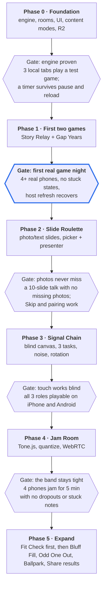

# Game Night — Implementation Plan

What to build, in what order, and how we know each part is done. The design it builds is in the other docs and is locked by [DECISIONS.md](DECISIONS.md).

Build the engine once, prove it with one offline game and one networked game, then add games in order of technical risk: images, then touch input, then real-time audio last.

## Roadmap

Each phase ends with a playtest gate. The next phase starts only once the gate passes.

The highlighted gate, a first real game night, is the one that proves the platform; everything after it is adding games.

| Phase              | Deliverables                                                                                                                                                                                                                   | Gate |
| ------------------ | ------------------------------------------------------------------------------------------------------------------------------------------------------------------------------------------------------------------------------ | ---- |
| 0. Foundation      | Monorepo, engine (reducer runner, game clock, pause, countdown, recovery), LoopbackTransport, UI kit basics, gallery and game page, content modes + validator, R2 bucket + `pnpm upload-media`, spec template, `pnpm new-game` | Engine proven |
| 1. First two games | Story Relay (Screen) and Gap Years (Party) on SupabaseTransport; `keepalive` table and daily job; 150 verified events; Vercel deploy; bots and debug overlay; first E2E tests                                                 | First real game night |
| 2. Slide Roulette  | Photo pool script, photo/text rotation and option sets, picker and presenter phones, Skip, loop pairing, reactions                                                                                                             | Photos never miss |
| 3. Signal Chain    | Black-screen input canvas, 3 tasks, Relay noise, role rotation                                                                                                                                                                 | Touch works blind |
| 4. Jam Room        | Tone.js instruments, quantized scheduling, WebRTCTransport, lanes visual                                                                                                                                                       | The band stays tight |
| 5. Expand          | Fit Check first (Dress up and Name the fit, wardrobe pipeline, shared voting module and free-text input), then Bluff Fill, Odd One Out, Ballpark; automated showcase screenshots; Share results (`shares` table, `/api/share`, `/s/[id]`) | — |

## How we work

- Steps are done in order. Each step ends with a **Done when** list; a step is done only when every item is checked.
- Mark progress here: `- [ ]` → `- [x]` as items land.
- **Running things.** The AI agent may run installs, builds, linters and tests, but first confirms with Kyle which suites it will run and what they need installed. Repo dev dependencies are normally fine; anything installed globally or outside the repo (a Node version, browser binaries, a CLI) needs explicit approval.
- **Manual tasks** are things only Kyle can do (accounts, dashboards, secrets). They're listed per step, marked 👤.
- If a step needs something the design doesn't cover, or conflicts with it, stop and ask before writing code (see [DECISIONS.md](DECISIONS.md#how-to-change-a-decision)).

## Tooling and installs

| Need | Where it installs | When | Status |
| ---- | ----------------- | ---- | ------ |
| Node.js 26 LTS | fnm; selected per repo by `.node-version`, the fnm default stays 22.2.0 | Before step 0.1 | Approved |
| pnpm 12.16 | Downloaded by the installed pnpm (12.6.0) from the `packageManager` field | Step 0.1 | Approved |
| All npm packages (Next, Turbo, Vitest, fast-check, Zod, ...) | Repo dev/runtime dependencies | Step 0.1 onward | Allowed |
| Playwright browsers | User cache, outside the repo (~500 MB) | Phase 1 | 👤 Needs approval |
| Supabase CLI | Repo dev dependency (`supabase`) | Phase 1 | Allowed |
| Docker Desktop | Already installed; needed by `supabase start` | Phase 1 | Present |

## Phase 0 — Foundation

Goal: everything a game needs, proven with a throwaway test game played across three browser tabs, with no network and no keys.

The test game is **Tap Tally** (`games/tap-tally`, status `prototype`): a 20-second round where each phone taps a big button and the most taps wins. It exercises intents, a timer, per-player views, scoring and pause, and is small enough to read in one sitting. It isn't a real game and can be removed after Phase 1.

### Step 0.1 — Monorepo skeleton

- pnpm workspace (`apps/*`, `packages/*`, `games/*`) and `turbo.json` with `build`, `dev`, `lint`, `typecheck`, `test` tasks.
- Root `package.json` with `packageManager` and `engines`; `.node-version`; `.gitignore` covering `.env*.local`, `.next`, `.turbo`, `node_modules`, coverage.
- `packages/config`: base `tsconfig` (strict), ESLint flat config, Tailwind v4 theme CSS with the `--gn-*` tokens.
- `apps/web`: Next.js 16 App Router app with Tailwind, rendering a placeholder home page.
- `.env.example` listing every variable from [ARCHITECTURE.md](ARCHITECTURE.md#environment-variables), with no values.
- Settle TypeScript 7 vs 6.x (see D-020) and record the outcome.

**Done when**

- [ ] `pnpm install`, `pnpm build`, `pnpm lint` and `pnpm typecheck` pass from a clean clone.
- [ ] `pnpm dev` serves the placeholder page with a token color applied.
- [ ] A package importing another workspace package type-checks.

### Step 0.2 — Engine core (`packages/engine`)

- `GameDefinition`, `Action`, `Ctx`, `SetupCtx` and `game.json` types and Zod schemas, as in [ARCHITECTURE.md](ARCHITECTURE.md#the-game-definition).
- Game clock with an injected time source; timers as `{ id, endsAt }` data; the runner fires `timer` actions.
- Status machine: lobby → countdown → running ⇄ paused → ended, exactly the 5 states and 7 transitions in the pause diagram.
- Seeded RNG (serializable, so recovery replays the same sequence).
- Intent pipeline: schema validation, reducer rejection with a reason, dedupe by intent id.
- Recovery snapshot `{ state, accumulatedMs, seed }` behind an injected storage interface; restore always lands in Paused.
- Scoring helpers: rank players with ties.
- Tap Tally's `logic.ts` and `views.ts`.

**Done when**

- [ ] Vitest: clock and timers freeze on pause and resume with the same remaining time.
- [ ] Vitest: every illegal status transition is rejected; the 7 legal ones work.
- [ ] Vitest: restoring a snapshot lands in Paused and resuming continues the same game.
- [ ] fast-check property: for any sequence of intents, pausing at any moments for any durations and resuming gives the same final state as never pausing.
- [ ] Vitest: Tap Tally's scoring and phase flow.
- [ ] `packages/engine` has no React or DOM imports (lint rule).

### Step 0.3 — Rooms and LoopbackTransport (`packages/realtime`)

- `Transport` interface: join a channel, presence track/observe, send, subscribe.
- `LoopbackTransport` on BroadcastChannel, plus an in-memory transport for unit tests.
- Room codes: generator (20 consonants, no Z) and the 1 s presence claim check.
- Protocol v1 Zod schemas for `ToHost` / `ToPlayer` ([PROTOCOL.md](PROTOCOL.md#message-envelope)).
- Host session: watches presence, joins per-player channels, answers `hello` with `welcome`, sends views only when their hash changes, increments `seq`, acks intents.
- Player session: repeats `hello` until `welcome`, drops stale `seq`, stores player id per room, "Room not found" after 3 s, "Refresh to play" on a version mismatch, "Waiting for host" when the host leaves.

**Done when**

- [ ] Vitest (in-memory transport): join, reconnect with the same id, kick, host drop and return, stale `seq` ignored, duplicate intent ignored.
- [ ] Vitest: a view that didn't change is not resent.
- [ ] Vitest: room code generator never emits vowels or Z, and the claim retries on a taken code.

### Step 0.4 — React bindings and UI kit basics (`packages/ui`)

- Zustand store fed by the engine; hooks `useGame`, `useTimer`, `usePhaseEffect`, `usePlayers`.
- Components: Lobby (code, QR, player list, settings form generated from the config schema, start), RoomCode, PlayerList, AvatarPicker, Countdown, PauseOverlay, PauseMenu, TimerRing, TimerBar, Scoreboard, BigButton, SubmitLock, WakeLock, FullscreenToggle.
- `data-paused` on the root pauses CSS animations; Space / P pauses on the host; hidden host tab auto-pauses.
- Theming through `[data-game]` overrides of the `--gn-*` tokens.

**Done when**

- [ ] Vitest + Testing Library: `useTimer` stops counting while paused; the settings form renders from a Zod schema.
- [ ] Components render at 1920×1080 (host) and 390×844 (phone) without overflow on a dev page.

### Step 0.5 — Site: gallery, game page, play surfaces

- `registry.ts` with lazy `load()`; `transpilePackages` for `@games/*`.
- `/` gallery with cards, mode badges, player count, minutes, status badge, filters by mode and player count; accent-color placeholder when there's no media.
- `/games/[slug]` with the how-to-play block extracted from SPEC.md at build time.
- `/games/[slug]/play` host and single-screen surfaces; `/join`; `/j/[code]` controller; all on LoopbackTransport.
- Crash recovery prompt "Resume game ABCD?" on host reload; leave-page confirmation on the host; pull-to-refresh disabled on the controller.
- Minimal `?debug=1` overlay: current state, clock status, message log.

**Done when**

- [ ] Tap Tally appears in the gallery with a "prototype" badge and its how-to-play on its game page.
- [ ] One host tab and two phone tabs (`/j/ABCD`) play a full Tap Tally round on one machine.

### Step 0.6 — Content, media and tooling

- `packages/content`: rating schema, `pickContent(pool, mode, rng)` with the After dark 60% weighting, shared word list format.
- Lobby content-mode picker, the After dark adult confirmation, and the mode badge on host and phones.
- `pnpm validate-content` with the rules in [CONTENT_GUIDE.md](CONTENT_GUIDE.md#validation-pnpm-validate-content), plus a per-game rule hook.
- `packages/media`: `mediaUrl(key)` built on `NEXT_PUBLIC_MEDIA_URL`.
- `pnpm upload-media`: walks each game's `media/`, content-hashes file names, uploads to R2 with the immutable cache header, writes a manifest the app reads, skips files already uploaded.
- `pnpm new-game <slug>`: copies the game template, creates SPEC.md from [GAME_SPEC_TEMPLATE.md](GAME_SPEC_TEMPLATE.md), adds the registry entry.
- 👤 Create the R2 bucket `game-night`, connect `game-night.kylehagerman.dev` as its custom domain, add CORS for GET from production, Vercel preview and localhost origins, and create an R2 API token scoped to that bucket. Put the token in `.env.local`.

**Done when**

- [ ] Vitest: `pickContent` never returns an entry above the room's mode, and After dark draws roughly 60% after-dark entries over many seeds.
- [ ] `pnpm validate-content` fails on a fixture with a missing rating and passes on Tap Tally's content.
- [ ] `pnpm new-game demo-game` produces a package that builds and shows in the gallery (then delete it).
- [ ] `pnpm upload-media` uploads a test image, and it loads from `https://game-night.kylehagerman.dev/...` in the browser with the expected `Cache-Control`.

### Gate 0 — Engine proven

- [ ] 3 local tabs play Tap Tally start to finish.
- [ ] Pausing from a phone mid-timer freezes every tab; resuming shows 3-2-1 everywhere and the timer continues from where it stopped.
- [ ] Reloading the host mid-round offers "Resume game", restores into Paused, and the phones rejoin without re-entering names.

## Phase 1 — First two games

Expand both specs to the full template first (D-005).

- Story Relay (Screen): see [its spec](../games/story-relay/SPEC.md).
- Gap Years (Party): see [its spec](../games/gap-years/SPEC.md); 150 verified events.
- `SupabaseTransport`; local Supabase stack for development and E2E.
- `keepalive` migration and `/api/cron/keepalive` Vercel Cron job, protected by `CRON_SECRET`.
- Site checks Realtime on load and shows a clear message if it's down.
- `packages/audio` basics: audio unlock, SFX, `speechSynthesis` and speech recognition helpers.
- `packages/devtools`: fake-player bots from each game's `intentSchema`; full debug overlay (simulated disconnect, added latency).
- Playwright E2E, one browser context per device, against LoopbackTransport and the local Supabase stack.
- 👤 Create the Supabase project; create the Vercel project and set environment variables; decide the production site domain (needed for CORS and QR links).

## Phase 2 — Slide Roulette

See [its spec](../games/slide-roulette/SPEC.md). Photo pool script (`pnpm build:images`), photo/text rotation and option sets, picker and presenter phones, Skip, loop pairing, reactions. 👤 Pexels API key.

## Phase 3 — Signal Chain

See [its spec](../games/signal-chain/SPEC.md). Black-screen input canvas, Grid Tap + Swipe Combo + Dial, Relay noise, role rotation.

## Phase 4 — Jam Room

See [its spec](../games/jam-room/SPEC.md). Tone.js instruments, quantized scheduling, Supabase batching then WebRTCTransport, lanes visual.

## Phase 5 — Expand

Fit Check comes first ([D-152](DECISIONS.md)): see [its spec](../games/fit-check/SPEC.md). Both variants, Dress up and Name the fit, are in its MVP ([D-150](DECISIONS.md)). It needs the wardrobe asset pipeline (`wardrobe:build`) and a launch wardrobe of about 15 items each for top, bottom and full-length, and it builds the shared voting module and free-text input that the later games reuse.

Then Bluff Fill, Odd One Out, Ballpark (see [IDEAS.md](IDEAS.md)); `pnpm screenshots` with showcase states; Share results ([ARCHITECTURE.md](ARCHITECTURE.md#share-results-later-not-mvp)).

## Testing

- **Logic unit tests (Vitest)** for every `logic.ts`: phase transitions, scoring with the worked examples from each spec, the Gap Years pair picker, Slide Roulette's minimum theme images.
- **Pause property test (fast-check):** for any sequence of intents, pausing at any moment and resuming gives the same final state as never pausing. This one test guards the core promise.
- **Engine tests** with an injected clock: timers freeze on pause, and recovery from a snapshot resumes into the paused state.
- **Multi-device end-to-end (Playwright):** one browser context per device against a local Supabase stack (`supabase start`), plus a fast variant using LoopbackTransport pages with `?device=` overrides.
- **Bots:** `packages/devtools` fills a room with fake players that send random valid intents generated from each game's `intentSchema`, so an 8-player game can be tested alone.
- **Debug overlay** (`?debug=1`): live state, message log, clock status, simulated disconnect and added latency.
- **Real-device checklist** before each game night: iPhone Safari, Android Chrome, the TV setup (laptop over HDMI or a cast tab).

## Risks

| Risk                                            | Impact                         | Mitigation                                                                                                                        |
| ----------------------------------------------- | ------------------------------ | --------------------------------------------------------------------------------------------------------------------------------- |
| Supabase free project pauses after a quiet week | Party games fail on game night | Daily keep-alive job, the only regular database activity; the site checks Realtime on load and shows a clear message if it's down |
| Realtime cap of 100 messages/s                  | Disconnects in busy games      | On-change views, per-player channels, batching, peer-to-peer for Jam Room                                                         |
| iPhone audio quirks                             | Silence                        | Unlock tap, `audioSession` playback, device checklist                                                                             |
| Speech recognition missing (Firefox, Edge)      | No transcripts                 | Story Relay is built to work with none                                                                                            |
| Pexels quota or terms change                    | No photos                      | Build-time photo pool; the AI-generated pool on R2 as a fallback                                                                  |
| After-dark lines next to photos of real people  | Breaks Pexels' guidelines      | After dark uses people-free photos and AI-generated people only                                                                   |
| Media served from the `r2.dev` URL              | Throttled previews and sounds  | Custom domain from day one                                                                                                        |
| Wrong dates in Gap Years                        | The bad kind of argument       | Source URL per event, validator, "report this" button on reveal                                                                   |
| Phones sleep or throttle background tabs        | Missed updates                 | Wake Lock; full views self-heal on reconnect                                                                                      |
| Scope creep across 16 game ideas                | Nothing gets finished          | Finish two games end to end before starting a third; status badges in the gallery                                                 |
| Latest-everything toolchain (TypeScript 7, Next 16.4, Vitest 5) | Incompatibilities between brand-new majors | Settle in step 0.1; fall back one major and record it in DECISIONS.md                                          |
